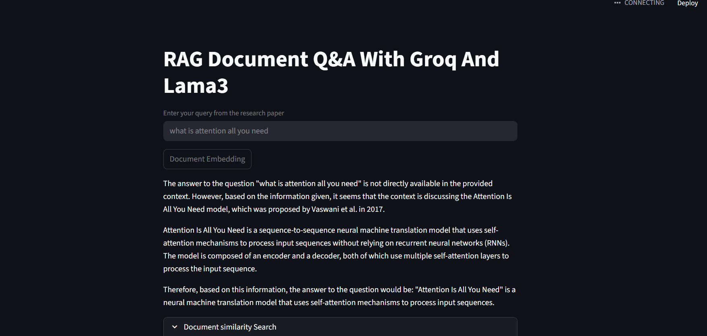
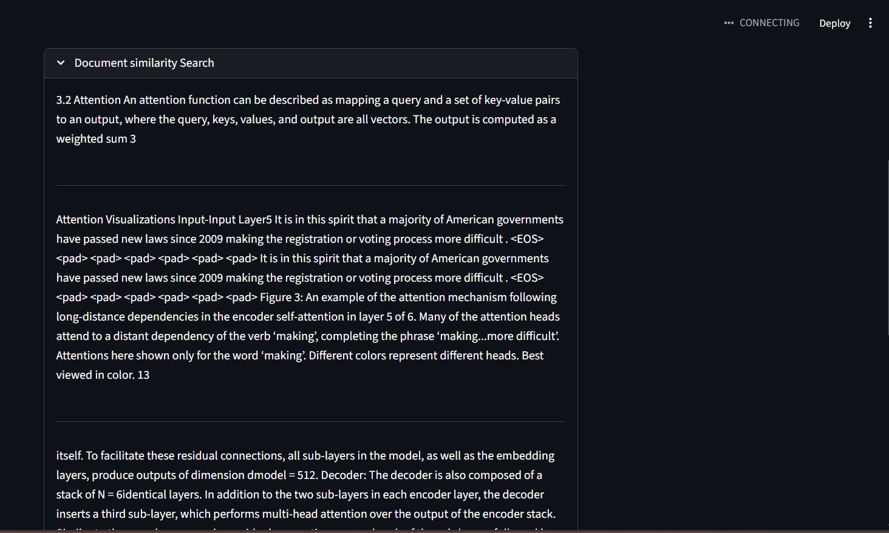

# RAG Document Q&A with Groq and LLaMA3

A **Retrieval-Augmented Generation (RAG) application** built using **LangChain**, **Groq-hosted LLaMA3**, **FAISS vector database**, and **Streamlit**.  
The system enables **context-aware question answering over PDF documents** using modern **LLM orchestration, embeddings, and semantic search** techniques.
This application allows users to query PDF research papers and receive accurate answers grounded strictly in the document context.

---

## 🚀 Features

- 📄 Load and process multiple PDF research papers
- 🧠 Create semantic embeddings using OpenAI Embeddings
- 🔍 Perform similarity search with FAISS vector database
- 🤖 Answer questions using **Groq-hosted LLaMA3-8B**
- ⚡ Fast inference with Groq API
- 🖥️ Interactive UI using Streamlit
- 📑 View retrieved document chunks for transparency

---

## 🏗️ Architecture Overview

1. **Document Ingestion**
   - PDFs are loaded from a local directory
   - Documents are split into overlapping chunks

2. **Embedding & Vector Storage**
   - Text chunks are converted into embeddings
   - Stored in FAISS for fast similarity search

3. **Retrieval-Augmented Generation (RAG)**
   - Relevant document chunks are retrieved
   - LLaMA3 generates answers using retrieved context only

4. **User Interface**
   - Streamlit provides a simple web interface
   - Users can embed documents and ask questions interactively

---

## 🛠️ Tech Stack

| Component | Technology |
|---------|------------|
| Frontend | Streamlit |
| LLM | LLaMA3-8B (Groq) |
| Framework | LangChain |
| Embeddings | OpenAI Embeddings |
| Vector DB | FAISS |
| Document Loader | PyPDFDirectoryLoader |
| Environment | Python, dotenv |

---

## 📸 Application Screenshots (Streamlit UI)

